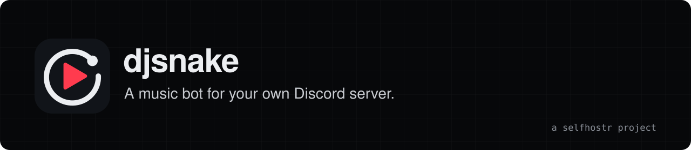

<div align="center">
<a href="https://djsnake.selfhostr.io"></a>

**A self-hosted Discord music bot with a live clip page that shows the video in sync.**

[Site](https://djsnake.selfhostr.io) · [Docs](https://djsnake.selfhostr.io/docs/) · [Demo](https://djsnake.selfhostr.io/demo/) · [Changelog](CHANGELOG.md)

[](https://github.com/selfhostr/djsnake/actions/workflows/ci.yml) [](LICENSE)
</div>

## Overview

`djsnake` plays what you paste in your voice channel: YouTube, Spotify, SoundCloud, Bandcamp, Deezer and Apple Music links, live streams, radios, or plain text searches. The bot posts a link to a clip page that shows the video in sync and controls the queue. Free, for good: MIT licence, no paid edition.

`djsnake` is an independent project, not affiliated with or endorsed by YouTube, Spotify or Discord.

## Quick start

In the [Discord Developer Portal](https://discord.com/developers/applications), create an application and add a bot. Enable the **Message Content Intent** and invite it with the `bot` and `applications.commands` scopes. Then:

```bash
git clone https://github.com/selfhostr/djsnake.git && cd djsnake
cp .env.example .env        # set DISCORD_TOKEN
docker compose pull && docker compose up -d
```

Join a voice channel and send `!play https://www.youtube.com/watch?v=...`. The clip page listens on `127.0.0.1:47823`: put a reverse proxy in front and set `PUBLIC_BASE_URL` to share it. Back up `./data` with `python -m djsnake.backup create`. Details: [installation](docs/source/installation.md), [configuration](docs/source/configuration.md), [backup](docs/source/backup.md).

## Features

- **Many sources.** Spotify, Deezer and Apple Music playlists are matched on YouTube with no account or API key.
- **Full queue control.** Per-server queue, loop, shuffle, crossfade, autoplay, 24/7 mode, vote-to-skip and a DJ role.
- **Automix.** SponsorBlock cuts, loudness normalised to -14 LUFS, silence trimmed, fades.
- **Hybrid commands.** Every command works as `!name` and as a slash command ([commands](docs/source/commands.md)).
- **Clip page.** Synced video, lyrics from LRCLIB, listening stats, eight themes, installable as an app ([guide](docs/source/clip-page.md)).
- **Saved playlists, audio filters and Last.fm scrobbling.**
- **Four languages.** English, French, Spanish and German, chosen per server.
- **Ops-friendly.** Health check, optional Prometheus metrics, automatic backups, self-updating yt-dlp ([keeping YouTube working](docs/source/youtube.md)).

## Architecture

One Python process runs the `discord.py` bot and the clip page web server, with yt-dlp and ffmpeg for audio and video. A `pot-provider` sidecar supplies YouTube PO tokens. State lives in JSON files and SQLite databases under `DATA_DIR`. See [architecture](docs/source/architecture.md).

## Limits

- Spotify, Deezer and Apple Music links are matched to YouTube videos, so the match can be the wrong version of a song.
- Tracks are fully downloaded before they play, at most 720p.
- Age-restricted and members-only videos need YouTube cookies from a throwaway account.
- Anyone who has the control link can control the queue. Treat it as a secret.
- For personal use. Respect YouTube's Terms of Service and the rights of the people whose videos you play.

## Contributing

Issues and pull requests are welcome: [CONTRIBUTING.md](CONTRIBUTING.md). Security issues: [SECURITY.md](SECURITY.md).

## License

MIT, see [LICENSE](LICENSE). Provided "as is", without warranty of any kind.

## Support

`djsnake` is free and has no company behind it. If it saves you time: [sponsor us on GitHub](https://github.com/sponsors/selfhostr).
